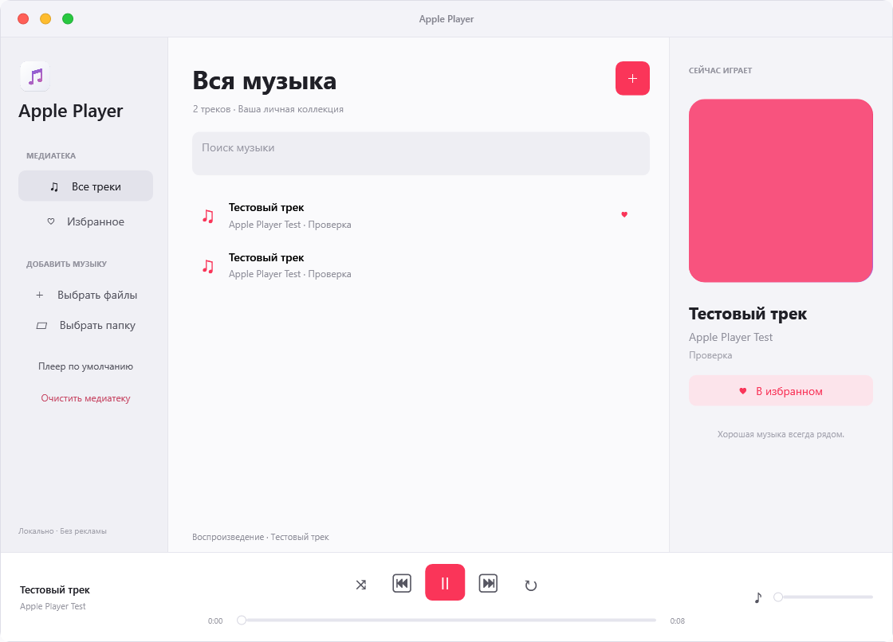
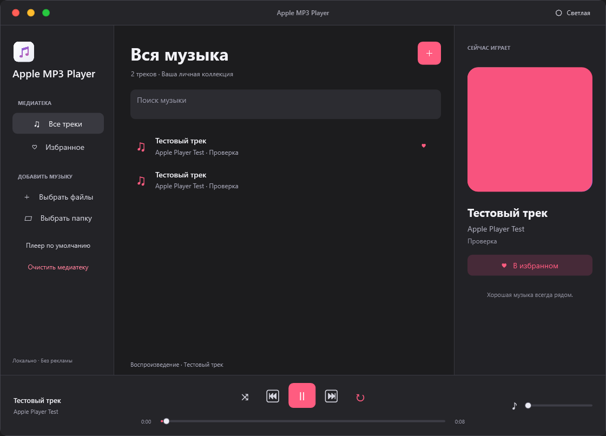
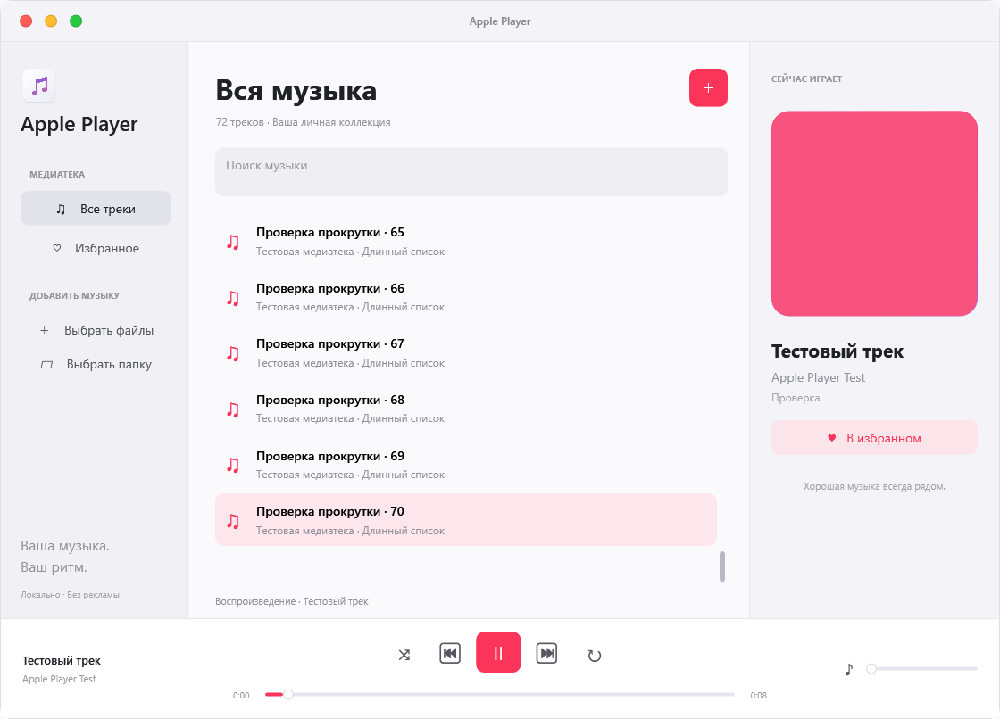

# Apple MP3 Player

Версия 1.1.1: папка проекта, EXE, установщик и ярлыки используют единое имя **Apple MP3 Player**. При первом запуске прежняя медиатека автоматически копируется в новую папку данных; исходные данные сохраняются как резерв.

Возможности версии 1.1.0: новое название и переключение светлой / тёмной темы кнопкой справа в заголовке. Выбор сохраняется и восстанавливается при следующем запуске. Основной EXE теперь называется `Apple MP3 Player.exe`. Обновление сохраняет медиатеку, размеры окна и назначение плеером по умолчанию.

В версии 1.0.4 плеер запоминает последнюю ширину и высоту окна, а также развёрнутое состояние. При следующем запуске они восстанавливаются. Сворачивание не меняет сохранённый размер; при уменьшении доступной области экрана окно подстраивается под неё.

Лёгкий музыкальный плеер для Windows с интерфейсом в духе Apple: светлая и тёмная палитры, розовый акцент, обложка альбома и минимум лишнего. Независимый проект, не связан с Apple Inc.

## Установка

Скачайте `Apple MP3 Player-Setup-1.1.1.exe` из [Releases](https://github.com/MaksimDenisov31/apple-mp3-player/releases/latest). Установщик работает без администратора. Можно использовать переносимый `Apple MP3 Player.exe`.

На последнем экране установщика отмечен пункт «Сделать Apple MP3 Player плеером по умолчанию». После «Готово» откроются настройки Windows: выберите Apple MP3 Player для MP3, WAV, M4A, AAC, WMA и FLAC и подтвердите выбор. Переход в эти настройки также доступен кнопкой «Плеер по умолчанию» в боковой панели. Windows требует подтвердить смену приложения по умолчанию; установщик не изменяет защищённый выбор через реестр. При тихой установке настройки не открываются.

Требования: Windows 10/11 и .NET Framework 4.8 (обычно уже установлен). В Windows N для воспроизведения требуется Media Feature Pack. Интернет для работы плеера не нужен.

## Использование

- Добавьте MP3, WAV, M4A, AAC, WMA или FLAC кнопкой «Выбрать файлы», выберите папку с подпапками или перетащите файлы в окно. Воспроизведение зависит от доступных кодеков Windows.
- Дважды щёлкните по треку для воспроизведения. Ползунок позволяет перематывать музыку.
- Поиск работает по названию, исполнителю и альбому. Метаданные и обложки читаются из ID3v2.3/2.4. Для неподдерживаемых тегов отображается имя файла.
- Сердечко добавляет текущий трек в избранное. Контекстное меню позволяет воспроизвести, добавить в избранное или убрать трек из библиотеки. Файлы на диске не удаляются.
- «Очистить медиатеку» убирает все добавленные треки и избранное после подтверждения. Воспроизведение останавливается, поиск, обложка и история переходов сбрасываются; громкость и режимы сохраняются. Музыкальные файлы на диске остаются. «Отмена» или Esc закрывают подтверждение без изменений. Музыку можно добавить снова.
- Кнопка повтора переключает режимы: выключен → все треки → один трек. Случайный порядок не выбирает текущий трек повторно, если есть другие.
- «Далее» и «Назад» работают по текущему списку поиска / избранного. После трёх секунд воспроизведения «Назад» возвращает к началу трека.
- `Ctrl+O` — добавить файлы; `Пробел` — пауза / воспроизведение; `Ctrl+←/→` — предыдущий / следующий.
- Круглые кнопки слева сверху: красная закрывает окно, жёлтая сворачивает, зелёная разворачивает и восстанавливает. Заголовок можно перетаскивать; двойной щелчок разворачивает окно. Размер меняется за края и углы. Развёрнутое окно оставляет панель задач доступной.
- Установщик регистрирует Apple MP3 Player для `.mp3`, `.wav`, `.m4a`, `.aac`, `.wma`, `.flac`. В Windows 11 открывается страница плеера; в Windows 10 при необходимости найдите его на общей странице приложений по умолчанию.

Библиотека, избранное, громкость и режимы сохраняются в `%LOCALAPPDATA%\Apple MP3 Player\library.json`. Музыка не копируется и не загружается в сеть. Обновление и удаление приложения не удаляют музыку и библиотеку. При следующем запуске выбранный трек восстанавливается без автоматического воспроизведения. Запускайте одну копию плеера для работы с библиотекой.

## Сборка

1. Windows, .NET Framework 4.8 и Inno Setup 6.
2. `powershell -STA -NoProfile -ExecutionPolicy Bypass -File tools\MakeIcon.ps1` — пересоздать векторную музыкальную иконку в девяти размерах при необходимости.
3. `Build.bat` — собрать `bin\Apple MP3 Player.exe` компилятором .NET Framework, без NuGet. Копия в корне обновляется, если не запущена. Установщик и переносимый архив всегда используют новую сборку из `bin`, поэтому старый плеер не нужно принудительно закрывать для сборки.
4. `BuildInstaller.bat` — собрать EXE и установщик в `installer-output`.

## Проверки

`tools\Verify.ps1` создаёт синтетический MP3 с метаданными и обложкой через FFmpeg и запускает функциональные проверки на изолированной библиотеке: декодирование MP3, ход воспроизведения, пауза, перемотка, импорт, дубликаты, поиск, избранное, переходы, повтор, случайный порядок, сохранение и удаление из библиотеки без удаления файла. Снимок окна и протокол сохраняются в `.local/tests`.

`tools\VerifyInstaller.ps1` проверяет установку, запуск установленного EXE, обновление и удаление в изолированной папке и с отдельным идентификатором установщика; регистрации MP3 и пользовательские ярлыки в этом режиме не меняются.

Дополнительно проверяются воспроизведение пяти новых форматов, подтверждение и отмена очистки, сохранение пустой библиотеки, сохранность музыкальных файлов и настроек, отмена результатов незавершённого импорта, повторное добавление музыки. Установщик проверяется с изолированной регистрацией всех шести форматов, корректной командой открытия и сохранением прежних приложений по умолчанию.

Для длинной медиатеки дополнительно проверяются колесо мыши, перетаскивание ползунка, щелчок по полосе, переход к последнему треку клавишей End и скрытие полосы в коротком списке. Проверяются меню и подсказки. Снимки: `.local/tests/scrollbar.png`, `context-menu.png`, `tooltip.png`.

## Версия 1.1.1

Единое имя папки и исполняемого файла: `Apple MP3 Player`, `Apple MP3 Player.exe`. Пути сборки с пробелами поддерживаются. Данные прошлых версий автоматически переносятся без перезаписи уже обновлённых настроек. Установщик перенаправляет прежние ассоциации на новый EXE, сохраняя выбранное приложение по умолчанию.

## Версия 1.1.0

Apple MP3 Player: новое название в окне, ярлыках, установщике и списке приложений Windows. Светлая и тёмная темы, включая поиск, меню, подсказки и подтверждение очистки. Переключатель расположен справа сверху; тема сохраняется автоматически. При обновлении прежней версии используется её папка установки и прежняя медиатека.

## Версия 1.0.3

Выбор плеера по умолчанию из установщика и приложения; поддержка MP3, WAV, M4A, AAC, WMA, FLAC; очистка всей медиатеки с подтверждением без удаления файлов.

## Версия 1.0.2

Верхняя панель в стиле macOS с тремя круглыми кнопками слева. Новая иконка: сиреневая нота на светлой скруглённой плитке с прозрачными углами. Иконка встроена в EXE, окно и установщик; используется на панели задач и в боковой панели приложения. Библиотека и настройки сохраняются.

## Версия 1.0.1

Тонкая скруглённая полоса прокрутки без стандартных стрелок Windows, единое оформление контекстных меню треков и поиска, скруглённые подсказки. Библиотека и настройки сохраняются при обновлении.

## Версия 1.0.0

Первый выпуск: локальная медиатека MP3, обложки и метаданные ID3, избранное, поиск, управление воспроизведением, сохранение настроек, переносимый EXE и установщик.
